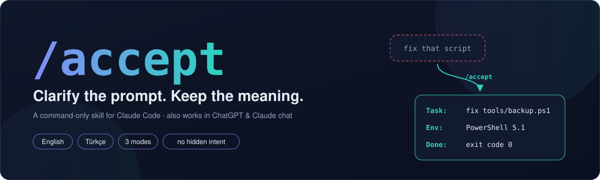
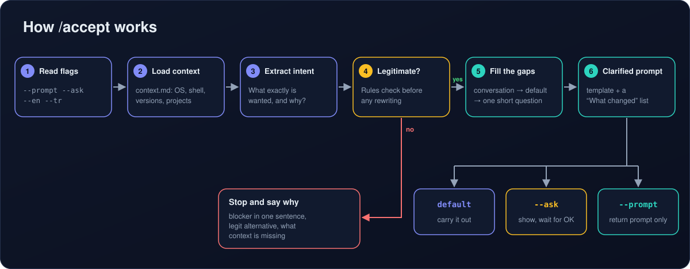
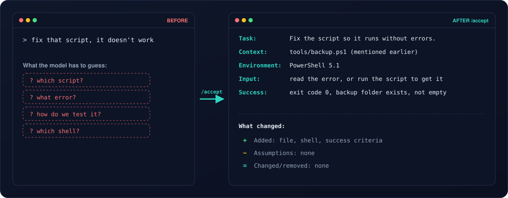
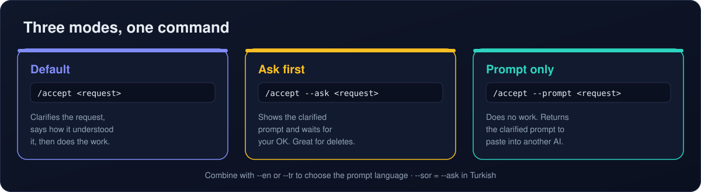
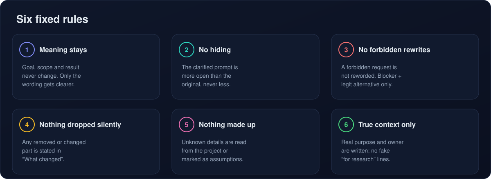

<div align="center">



🌐 **English** · [Türkçe](README.tr.md)


[](LICENSE)

</div>

---

**`/accept`** turns a vague request into a clear one **without changing what you asked for**, then carries it out. It fills in the missing context (which file, which environment, what "done" means), marks every guess as an assumption, and ends with a short **"What changed"** list so you can see exactly what was added.

It is a **command-only** skill: it runs when you type `/accept` and never activates on its own.

```text
/accept fix that script, it doesn't work
/accept --ask delete logs older than 30 days
/accept --prompt --en a script that merges PDFs
```

## Contents

- [Why](#why)
- [How it works](#how-it-works)
- [Before and after](#before-and-after)
- [Modes](#modes)
- [The six fixed rules](#the-six-fixed-rules)
- [Quick start](#quick-start)
- [Language support](#language-support)
- [Repository layout](#repository-layout)
- [Testing](#testing)
- [What it is not](#what-it-is-not)
- [Developers](#developers)
- [License](#license)

## Why

Most back-and-forth with an AI comes from missing context, not from hard problems. "Fix that script" leaves the model guessing: which script, what error, which shell, how to test it. Every guess is a chance for a wrong answer or another round of questions.

`/accept` does that clarifying step for you, in a fixed and predictable way:

- **It keeps your meaning.** Goal, scope and the result you asked for stay exactly the same.
- **It shows its work.** Every assumption is labeled, and anything changed or removed is called out.
- **It remembers your setup.** Put your OS, shell and projects in `context.md` once; it stops asking.

## How it works



1. **Read flags** — `--prompt`, `--ask`, `--en`, `--tr` are taken off the request.
2. **Load context** — facts from `context.md` (OS, shell, versions, projects) count as known.
3. **Extract intent** — what exactly is wanted, and why, in one sentence.
4. **Legitimacy check** — before any rewriting. A request that breaks the rules is *not* reworded: the skill states the blocker, offers a legitimate alternative and says what context is missing.
5. **Fill the gaps** — first from the conversation and the project, then a reasonable default marked as an *assumption*, and only if needed one short question.
6. **Clarified prompt** — written with a fixed template and followed by the "What changed" summary.

## Before and after



## Modes



| Command | What happens |
|---|---|
| `/accept <request>` | Clarifies, says *"Here is how I understood it: …"*, then does the work (asks first only if a guess would change the result a lot) |
| `/accept` | Clarifies your **previous** message |
| `/accept --ask <request>` | Shows the clarified prompt and waits for your OK (Turkish alias: `--sor`) |
| `/accept --prompt <request>` | Does no work; returns a clean prompt to paste into another AI or tool |
| `/accept --en …` / `--tr …` | Writes the clarified prompt in English / Turkish |

Flags can be combined, for example `/accept --prompt --en …`. An unknown flag is reported, never silently ignored.

## The six fixed rules



These rules are what make the output trustworthy. The full wording is in [`skill/accept/SKILL.md`](skill/accept/SKILL.md).

## Quick start

### Claude Code (terminal or desktop)

```bash
git clone https://github.com/Xyronb1/accept-skill.git
cd accept-skill
```

**Windows**

```powershell
powershell -ExecutionPolicy Bypass -File .\scripts\install.ps1
```

**macOS / Linux**

```bash
bash scripts/install.sh
```

Then fill in `~/.claude/skills/accept/context.md`, restart Claude Code and type `/accept`. An existing installation is never deleted; it is moved to `~/.claude/skills_backup/`. Manual install, per-project install and uninstall are covered in **[docs/INSTALL.md](docs/INSTALL.md)**.

### ChatGPT or Claude chat (web / app)

Paste [`prompts/universal-prompt.md`](prompts/universal-prompt.md) once into a Custom GPT, a ChatGPT/Claude Project, or your custom instructions. After that, start any message with `/accept` or `accept:`. Step by step: **[docs/CHAT-APPS.md](docs/CHAT-APPS.md)**.

## Language support

| | English | Türkçe |
|---|---|---|
| Replies, template labels, "What changed" summary | ✅ follows the language you write in | ✅ yazdığın dili takip eder |
| Force the prompt language | `--en` | `--tr` |
| "Ask first" flag | `--ask` | `--sor` |
| Universal chat prompt | [`universal-prompt.md`](prompts/universal-prompt.md) | [`universal-prompt.tr.md`](prompts/universal-prompt.tr.md) |
| Docs | [INSTALL](docs/INSTALL.md) · [Chat apps](docs/CHAT-APPS.md) | [Kurulum](docs/INSTALL.tr.md) · [Sohbet](docs/CHAT-APPS.tr.md) |

Other languages work too: the skill replies in whatever language you use. English and Turkish are the ones with built-in labels and examples.

## Repository layout

```text
accept-skill/
├── skill/accept/                  ← the folder Claude Code loads
│   ├── SKILL.md                   rules, flags and flow
│   ├── context.md                 your persistent context (OS, shell, projects)
│   ├── references/
│   │   ├── checklist.md           clarity checklist
│   │   └── examples.md            before / after examples (EN + TR)
│   └── templates/
│       └── clarified-prompt.md    output template + Turkish labels
├── prompts/
│   ├── universal-prompt.md        for ChatGPT / Claude chat (English)
│   └── universal-prompt.tr.md     for ChatGPT / Claude chat (Turkish)
├── scripts/
│   ├── install.ps1                Windows installer
│   └── install.sh                 macOS / Linux installer
├── tests/
│   ├── validate.ps1               structural checks for the skill files
│   └── test-scenarios.md          behavior scenarios to try by hand
├── docs/                          install and chat-app guides (EN + TR)
├── assets/                        README illustrations (EN + TR)
└── dist/accept-skill.zip          ready-to-extract skill folder
```

## Testing

```powershell
powershell -ExecutionPolicy Bypass -File .\tests\validate.ps1
```

`validate.ps1` checks the frontmatter (`name`, `disable-model-invocation`, description length), the flags, the required sections and files, and looks for stray control characters. It runs on Windows PowerShell 5.1 and on PowerShell 7 (`pwsh tests/validate.ps1` on macOS / Linux).

Behavior is checked by hand with the twelve scenarios in [`tests/test-scenarios.md`](tests/test-scenarios.md): a clear request is not inflated, a request is never narrowed, no invented justifications, `--prompt` does no work, `--ask` waits, Turkish in → Turkish out, and more.

## What it is not

`/accept` is **not** a filter-bypass tool. It does not reword, hide or dress up a forbidden request, and it does not analyze safety filters or guess "what to change so it passes". For an innocent request that is easy to misread, it adds only **true, concrete** context (whose data, where it runs, what for), never empty lines like *"this is for educational purposes"*.

## Developers

`/accept` is built by a core team of three:

<table>
<tr>
<td align="center" width="33%">
<br>
<a href="https://github.com/Xyronb1"><b>Xyron</b></a><br>
<sub>Core developer</sub><br>
<sub>Creator · idea, design, testing</sub>
</td>
<td align="center" width="33%">
<br>
<a href="https://www.anthropic.com"><b>Claude</b></a><br>
<sub>Core developer</sub><br>
<sub>AI developer · Claude Opus 5.5 by Anthropic</sub>
</td>
<td align="center" width="33%">
<br>
<a href="https://github.com/mirac221"><b>mirac221</b></a><br>
<sub>Core developer</sub><br>
<sub>Testing and code help</sub>
</td>
</tr>
</table>

Issues and pull requests are welcome. If you add a language, add its labels to [`templates/clarified-prompt.md`](skill/accept/templates/clarified-prompt.md) and a scenario to [`tests/test-scenarios.md`](tests/test-scenarios.md).

## License

Released under the [MIT License](LICENSE). You are free to use, change and share it, including commercially; just keep the license and copyright notice.
