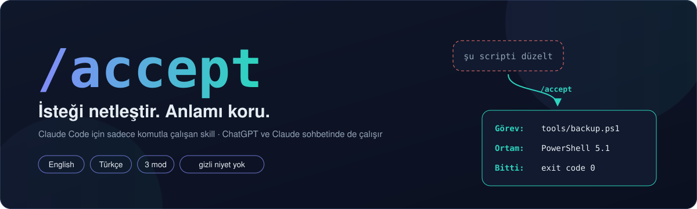
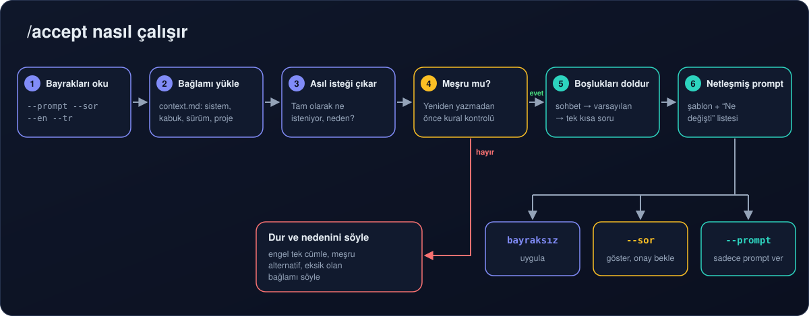
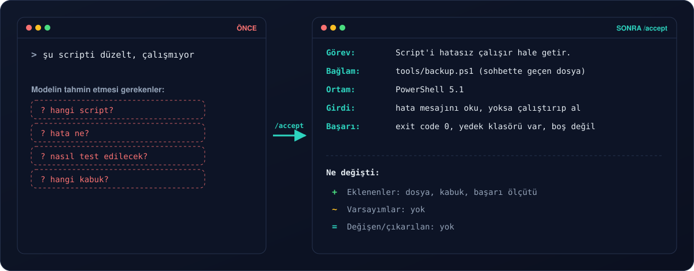
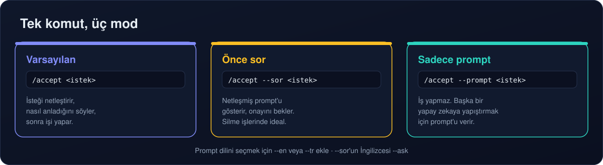
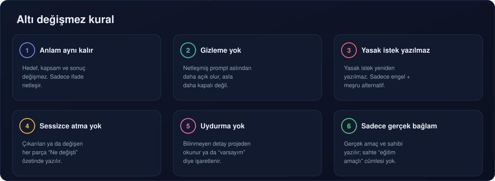

<div align="center">



🌐 [English](README.md) · **Türkçe**


[](LICENSE)

</div>

---

**`/accept`**, muğlak bir isteği **ne istediğini değiştirmeden** net hale getirir ve uygular. Eksik bağlamı doldurur (hangi dosya, hangi ortam, "bitti" ne demek), her tahmini "varsayım" diye işaretler ve sonunda kısa bir **"Ne değişti"** listesi verir; neyin eklendiğini tek bakışta görürsün.

**Sadece komutla çalışır:** `/accept` yazınca devreye girer, kendiliğinden asla çalışmaz.

```text
/accept şu scripti düzelt, çalışmıyor
/accept --sor 30 günden eski logları sil
/accept --prompt --en pdf'leri birleştiren bir script
```

## İçindekiler

- [Neden](#neden)
- [Nasıl çalışır](#nasıl-çalışır)
- [Önce ve sonra](#önce-ve-sonra)
- [Modlar](#modlar)
- [Altı değişmez kural](#altı-değişmez-kural)
- [Hızlı başlangıç](#hızlı-başlangıç)
- [Dil desteği](#dil-desteği)
- [Repo yapısı](#repo-yapısı)
- [Test](#test)
- [Ne değildir](#ne-değildir)
- [Geliştiriciler](#geliştiriciler)
- [Lisans](#lisans)

## Neden

Yapay zekayla yaşanan gidip gelmelerin çoğu zor problemlerden değil, eksik bağlamdan çıkar. "Şu scripti düzelt" dediğinde model tahmin etmek zorunda kalır: hangi script, hata ne, hangi kabuk, nasıl test edilecek. Her tahmin yanlış cevap ya da yeni bir soru turu demek.

`/accept` bu netleştirme adımını senin yerine, sabit ve öngörülebilir bir şekilde yapar:

- **Anlamı korur.** Hedef, kapsam ve istediğin sonuç aynen kalır.
- **Ne yaptığını gösterir.** Her varsayım etiketlenir; değişen ya da çıkarılan her şey açıkça yazılır.
- **Ortamını hatırlar.** İşletim sistemini, kabuğunu ve projelerini bir kez `context.md`'ye yaz; bir daha sormaz.

## Nasıl çalışır



1. **Bayrakları oku** — `--prompt`, `--sor`/`--ask`, `--en`, `--tr` istekten ayrılır.
2. **Bağlamı yükle** — `context.md`'deki bilgiler (sistem, kabuk, sürümler, projeler) bilinen sayılır.
3. **Asıl isteği çıkar** — tam olarak ne isteniyor ve neden, tek cümleyle.
4. **Meşruiyet kontrolü** — yeniden yazmadan önce. Kurallara aykırı bir istek yeniden *yazılmaz*: skill engeli söyler, meşru bir alternatif önerir ve hangi bağlamın eksik olduğunu belirtir.
5. **Boşlukları doldur** — önce sohbetten ve projeden, sonra *varsayım* diye işaretlenen makul bir varsayılanla, gerekirse tek kısa bir soruyla.
6. **Netleşmiş prompt** — sabit bir şablonla yazılır, ardından "Ne değişti" özeti gelir.

## Önce ve sonra



## Modlar



| Komut | Ne olur |
|---|---|
| `/accept <istek>` | Netleştirir, *"Şöyle anladım: …"* der, sonra işi yapar (sadece bir tahmin sonucu ciddi değiştirecekse önce sorar) |
| `/accept` | **Bir önceki** mesajını netleştirir |
| `/accept --sor <istek>` | Netleşmiş prompt'u gösterir, onayını bekler (İngilizcesi: `--ask`) |
| `/accept --prompt <istek>` | İş yapmaz; başka bir yapay zekaya/araca yapıştırmak için temiz bir prompt verir |
| `/accept --en …` / `--tr …` | Netleşmiş prompt'u İngilizce / Türkçe yazar |

Bayraklar birleşebilir, ör. `/accept --prompt --en …`. Tanınmayan bir bayrak söylenir, sessizce yok sayılmaz.

## Altı değişmez kural



Çıktıyı güvenilir yapan bu kurallardır. Tam metni [`skill/accept/SKILL.md`](skill/accept/SKILL.md) içinde.

## Hızlı başlangıç

### Claude Code (terminal veya masaüstü)

```bash
git clone https://github.com/Xyronb1/accept-skill.git
cd accept-skill
```

**Windows**

```powershell
powershell -ExecutionPolicy Bypass -File .\scripts\install.ps1
```

**macOS / Linux**

```bash
bash scripts/install.sh
```

Sonra `~/.claude/skills/accept/context.md`'yi doldur, Claude Code'u yeniden başlat ve `/accept` yaz. Mevcut bir kurulum asla silinmez, `~/.claude/skills_backup/` klasörüne taşınır. Elle kurulum, tek projeye kurulum ve kaldırma: **[docs/INSTALL.tr.md](docs/INSTALL.tr.md)**.

### ChatGPT veya Claude sohbeti (web / uygulama)

[`prompts/universal-prompt.tr.md`](prompts/universal-prompt.tr.md) metnini bir kez Custom GPT'ye, ChatGPT/Claude Project'ine ya da özel talimatlarına yapıştır. Sonra herhangi bir mesaja `/accept` veya `accept:` ile başla. Adım adım: **[docs/CHAT-APPS.tr.md](docs/CHAT-APPS.tr.md)**.

## Dil desteği

| | English | Türkçe |
|---|---|---|
| Cevaplar, şablon etiketleri, "Ne değişti" özeti | ✅ follows the language you write in | ✅ yazdığın dili takip eder |
| Prompt dilini zorla | `--en` | `--tr` |
| "Önce sor" bayrağı | `--ask` | `--sor` |
| Evrensel sohbet prompt'u | [`universal-prompt.md`](prompts/universal-prompt.md) | [`universal-prompt.tr.md`](prompts/universal-prompt.tr.md) |
| Dokümanlar | [INSTALL](docs/INSTALL.md) · [Chat apps](docs/CHAT-APPS.md) | [Kurulum](docs/INSTALL.tr.md) · [Sohbet](docs/CHAT-APPS.tr.md) |

Başka diller de çalışır: skill hangi dilde yazarsan o dilde cevap verir. Hazır etiket ve örnekleri olan diller İngilizce ve Türkçe.

## Repo yapısı

```text
accept-skill/
├── skill/accept/                  ← Claude Code'un yüklediği klasör
│   ├── SKILL.md                   kurallar, bayraklar ve akış
│   ├── context.md                 kalıcı bağlamın (sistem, kabuk, projeler)
│   ├── references/
│   │   ├── checklist.md           netlik kontrol listesi
│   │   └── examples.md            önce / sonra örnekleri (EN + TR)
│   └── templates/
│       └── clarified-prompt.md    çıktı şablonu + Türkçe etiketler
├── prompts/
│   ├── universal-prompt.md        ChatGPT / Claude sohbeti için (İngilizce)
│   └── universal-prompt.tr.md     ChatGPT / Claude sohbeti için (Türkçe)
├── scripts/
│   ├── install.ps1                Windows kurulumu
│   └── install.sh                 macOS / Linux kurulumu
├── tests/
│   ├── validate.ps1               skill dosyalarının yapı kontrolü
│   └── test-scenarios.md          elle denenecek davranış senaryoları
├── docs/                          kurulum ve sohbet rehberleri (EN + TR)
├── assets/                        README görselleri (EN + TR)
└── dist/accept-skill.zip          çıkarmaya hazır skill klasörü
```

## Test

```powershell
powershell -ExecutionPolicy Bypass -File .\tests\validate.ps1
```

`validate.ps1` frontmatter'ı (`name`, `disable-model-invocation`, açıklama uzunluğu), bayrakları, gerekli bölüm ve dosyaları kontrol eder, kaçak kontrol karakteri arar. Windows PowerShell 5.1'de ve PowerShell 7'de çalışır (macOS / Linux'ta `pwsh tests/validate.ps1`).

Davranış, [`tests/test-scenarios.md`](tests/test-scenarios.md) içindeki on iki senaryoyla elle kontrol edilir: net istek şişirilmez, istek asla daraltılmaz, uydurma gerekçe yok, `--prompt` iş yapmaz, `--sor` bekler, Türkçe giriş → Türkçe çıkış ve dahası.

## Ne değildir

`/accept` bir filtre atlatma aracı **değildir**. Yasak bir isteği yeniden yazmaz, gizlemez, kılıf uydurmaz; güvenlik filtrelerini analiz etmez, "neyi değiştirsen geçer" tahmini yapmaz. Masum ama yanlış anlaşılmaya açık bir istekte sadece **doğru ve somut** bağlamı ekler (kimin verisi, nerede çalışıyor, ne için); *"bu eğitim amaçlıdır"* gibi boş cümleler eklemez.

## Geliştiriciler

`/accept`'i üç kişilik ana ekip geliştiriyor:

<table>
<tr>
<td align="center" width="33%">
<br>
<a href="https://github.com/Xyronb1"><b>Xyron</b></a><br>
<sub>Ana geliştirici</sub><br>
<sub>Yaratıcı · fikir, tasarım, test</sub>
</td>
<td align="center" width="33%">
<br>
<a href="https://www.anthropic.com"><b>Claude</b></a><br>
<sub>Ana geliştirici</sub><br>
<sub>Yapay zeka geliştirici · Anthropic'in Claude Opus 5.5 modeli</sub>
</td>
<td align="center" width="33%">
<br>
<a href="https://github.com/mirac221"><b>mirac221</b></a><br>
<sub>Ana geliştirici</sub><br>
<sub>Test ve kod desteği</sub>
</td>
</tr>
</table>

Issue ve pull request'lere açığız. Yeni bir dil eklersen etiketlerini [`templates/clarified-prompt.md`](skill/accept/templates/clarified-prompt.md)'ye, bir senaryoyu da [`tests/test-scenarios.md`](tests/test-scenarios.md)'ye ekle.

## Lisans

[MIT Lisansı](LICENSE) ile yayınlanmıştır. Ticari kullanım dahil serbestçe kullanabilir, değiştirebilir ve paylaşabilirsin; tek şart lisans ve telif notunu korumak.
